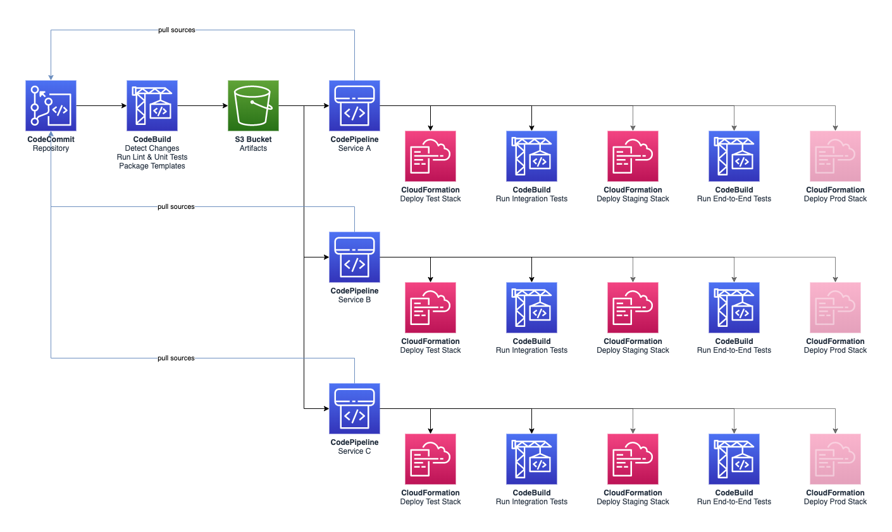

# ACME Shop: Delivery Pipeline

CI/CD pipeline that builds, tests and promotes every service through dev, staging and production.

- Component: `delivery-pipeline` (pipeline, production)
- Owner: **no owner (unassigned since the platform reorg)**
- System: `commerce-platform`

## Origin and license

This repository is derived from [aws-samples/aws-serverless-ecommerce-platform](https://github.com/aws-samples/aws-serverless-ecommerce-platform) at commit [`3b9ef36`](https://github.com/aws-samples/aws-serverless-ecommerce-platform/tree/3b9ef36dd3e338c8ab697c2bcb1b672e064e303c), split out of that monorepo with its commit history and modified as listed below. Original code: Copyright 2019 Amazon.com, Inc. or its affiliates, licensed under MIT-0 (see [LICENSE](LICENSE)).

ACME Retail Group is a fictional company used for demos. This repository is not affiliated with, or endorsed by, Amazon Web Services.

## Changes from upstream

- Split out of the upstream monorepo into one repository per service, with history.
- The shared `ecom` library is installed from [acme-shop-ecom-lib](https://github.com/kaku0/acme-shop-ecom-lib) instead of a relative path.
- SSM-backed template parameters have a `dev` default, so the template can be read on its own.
- `catalog-info.yaml` (Backstage) describes ownership, system, APIs and dependencies.
- Build tooling for all services (`tools/`, and the former root Makefile as `tools/Makefile.services`) lives here.

---

Ecommerce Platform Pipeline
===========================

Whenever there is a commit pushed to the main branch of the [CodeCommit repository](https://aws.amazon.com/codecommit/), this triggers a [CodeBuild project](https://aws.amazon.com/codebuild/) that will detect which services have changed since the last project execution, run lint and unit tests and send artifacts to an S3 bucket. See [resources/buildspec-build.yaml](resources/buildspec-build.yaml) for the build specification.

Each service has its own [pipeline powered by CodePipeline](https://aws.amazon.com/codepipeline/). When a new version of the artifacts for that service is uploaded to S3, this will trigger the pipeline.

The pipeline will first fetch the sources from CodeCommit, deploy the stack to a testing environment and run integration tests against that stack. See [resources/buildspec-tests.yaml](resources/buildspec-tests.yaml) for the build specification.